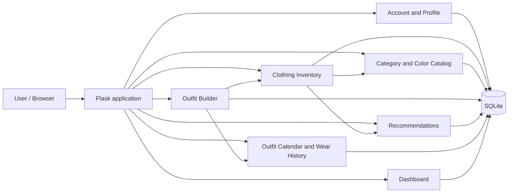

# Fitora — Project Scope & System Design

> **192-201 Advanced Computer Programming with Generative AI — Term Project**

| Item | Detail |
| --- | --- |
| Group number | To be confirmed |
| Repository link | [ACP_final_project_edamame](https://github.com/lwinDoubleOmega/ACP_final_project_edamame) |
| Version / date | v1.0 — 08/11/2026 |
| Status | Draft |

---

## 1. Project Overview 🟢 REQUIRED

**1.1 Problem statement**  
People with varied wardrobes can find it difficult to keep track of their clothing, combine items into useful outfits, and remember what they plan to wear or have already worn. Without an organized record, outfit planning and wardrobe use become harder to manage.

**1.2 Proposed solution**  
Fitora is a Flask web application that lets each user maintain a digital wardrobe, organize clothing with a shared category and color catalog, create and save outfits, receive explainable rule-based recommendations, and schedule outfits while keeping wear history. Data is stored in SQLite and user-owned records are associated with the relevant account.

**1.3 Target users**

| User role | What they do in the system |
| --- | --- |
| Registered user | Manages their account, clothing, categories, outfits, recommendations, schedules, and wear history. |
| Development team / lecturer | Reviews the application, its feature implementations, tests, and AI usage record. |

**1.4 Platform**
- [x] Web (Flask)
- [ ] Mobile (Flet)
- Database: SQLite

---

## 2. Team Members 🟢 REQUIRED

| # | Name | Student ID | GitHub username | Role | Feature owned |
| --- | --- | --- | --- | --- | --- |
| 1 | Lwin Oo (Edward) | 6705140051 | [lwinDoubleOmega](https://github.com/lwinDoubleOmega) | **Team Lead** + Developer | Clothing Inventory |
| 2 | Wathan Htat (Frost) | 6705140052 | [callmefrost27-dotcom](https://github.com/callmefrost27-dotcom) | Developer | Category & Color Catalog |
| 3 | Han Htoo Aung (Erics) | 6705140067 | [Erics12487254](https://github.com/Erics12487254) | Developer | Outfit Builder |
| 4 | Ngyein Chan Ko (Reka) | 6705140061 | [Reka1X](https://github.com/Reka1X) | Developer | User Account & Profile Management |
| 5 | Nyi Sett (August) | 6705140078 | [Whale_0134](https://github.com/Whale_0134) | Developer | Outfit Recommendations |
| 6 | Kaung Myat Tun (Kingston) | 6705140059 | [Kaungmyattun8](https://github.com/Kaungmyattun8) | Developer | Outfit Calendar & Wear History |
| 7 | Aung Khant Paing (Trevor) | 6705140082 | [Trevor0v0](https://github.com/Trevor0v0) | Developer | Core Application & Dashboard |

The team lead coordinates communication and reports progress to the lecturer. Member 7 owns shared application setup and integration; Member 4 owns account and authentication implementation.

---

## 3. Project Scope 🟢 REQUIRED

**3.1 In scope**
- Register, log in, log out, view and edit a user profile, and change a password.
- Create, view, edit, delete, search, and filter clothing items; upload or capture JPG/PNG photos up to 5 MB; manage item availability.
- Browse predefined categories and colors, and create, edit, and delete user-owned categories subject to catalog rules.
- Create and manage outfits using clothing items, preserving item snapshots and excluding unavailable items from new outfits.
- Generate, view, and delete deterministic, explainable outfit recommendations from available clothing and occasion/style criteria.
- Schedule saved outfits, prevent duplicate outfit/date schedules, mark scheduled outfits as worn, and view wear history.
- Provide a shared dashboard, navigation, validated forms, feedback messages, and responsive browser pages.
- Persist data in SQLite with parameterized SQL, foreign keys, and user-level ownership checks.
- Provide automated pytest coverage for shared and feature behavior; each feature is planned to include at least eight meaningful tests.

**3.2 Out of scope**
- Online shopping, payments, or purchase processing.
- Required paid or hosted AI services. Generative AI is optional for natural-language recommendation explanations; the recommendation logic must work without it.
- Automatic clothing recognition, body measurements, or body-shape inference. Camera use is limited to capturing a photo for upload.
- Mobile applications, cloud synchronization, and production hosting.

**3.3 Assumptions and constraints**
- Use fake or sample data only; no real personal or institutional data is sent to AI tools.
- The application is a browser-based Flask project backed by SQLite.
- Each user's private records must be scoped to their `user_id`; shared predefined catalog entries are not owned by individual users.
- Categories created by users belong to their creator and must not be usable by another user.
- The calendar references saved outfits through `outfit_id`; it does not duplicate outfit records.
- Feature modules use Flask Blueprints and coordinate through agreed database models and service interfaces.

---

## 4. Features 🟢 REQUIRED

### 4.1 Feature summary

| Feature | Owner | Main class(es) | Table(s) it owns | Business rule (beyond CRUD) |
| --- | --- | --- | --- | --- |
| Clothing Inventory | Lwin Oo | `ClothingItem` → `TopItem`, `BottomItem`, `OnePieceItem`, `FootwearItem` | `clothing_items` | Category must match item type and be visible to the current user; new items are available by default; images are JPG/PNG up to 5 MB. |
| Category & Color Catalog | Wathan Htat | `CatalogEntry` → `CategoryEntry`, `ColorEntry` | `catalog_entries` | Normalize labels, prevent invalid duplicates, match categories to item types, and prevent deletion of entries in use. |
| Outfit Builder | Han Htoo Aung | `Outfit` → `CasualOutfit`, `FormalOutfit`, `SportOutfit` | `outfits`, `outfit_items` | A saved outfit uses available items and stores item snapshots so later inventory edits do not rewrite it. |
| User Account & Profile Management | Ngyein Chan Ko | `User` → `StandardUser` (and `AdminUser` only if administrator functionality is included) | `users` | Validate registration and credentials, prevent duplicate email accounts, securely hash passwords, and restrict profile access to its owner. |
| Outfit Recommendations | Nyi Sett | `Recommendation` → `ColorMatchRecommendation`, `OccasionMatchRecommendation`, `CapsuleRecommendation` | `recommendations`, `recommendation_items` | Score recommendations deterministically from available clothing and occasion/style criteria; explain scores; capsule suggestions provide versatile items for multiple combinations. |
| Outfit Calendar & Wear History | Kaung Myat Tun | `OutfitSchedule` → `CasualSchedule`, `WorkSchedule`, `EventSchedule` | `outfit_schedules`, `wear_history` | Prevent scheduling the same outfit twice on one date; reference the existing outfit and record outfits marked as worn. |
| Core Application & Dashboard | Aung Khant Paing | Flask application, shared helpers and dashboard components | No feature-owned domain tables | Register and integrate all feature Blueprints, shared database setup, navigation, and user-scoped dashboard summaries. |

### 4.2 Feature details

#### Feature: Clothing Inventory — Owner: Lwin Oo

**Description:** Users add, browse, search, filter, edit, and delete their clothing items, including an uploaded or captured photo, catalog color and category, style, and availability. The feature supplies item details to outfit building and recommendations.

**Minimum checklist (Feature Contract):**
- [x] OOP hierarchy and polymorphic `outfit_role()` are specified in `TASKS.md`.
- [x] CRUD, parameterized SQL, search/filtering, validation, business rules, and at least eight pytest cases are assigned in `TASKS.md`.
- [x] Shared AI documentation is recorded in the root `PROMPT_LOG.md`.

**Business rule:** Item category must match its type and be predefined or owned by the current user. Shoes map to `FootwearItem`; items start available; accepted images are JPG/PNG up to 5 MB.  
**Independence check:** Clothing items can be created and managed as their own records; catalog-backed selections are validated through the catalog interface.  
**Optional extras planned:** Camera capture for uploading a photo; automatic recognition is out of scope.

#### Feature: Category & Color Catalog — Owner: Wathan Htat

**Description:** Provides shared predefined colors and categories to the clothing form and lets users manage their own categories. Users cannot create colors through the clothing form.

**Minimum checklist (Feature Contract):**
- [x] `CatalogEntry` parent and `CategoryEntry` / `ColorEntry` children with polymorphic methods are specified in `TASKS.md`.
- [x] Catalog CRUD, validation, ownership, visibility, and at least eight pytest cases are assigned in `TASKS.md`.
- [x] Shared AI documentation is recorded in the root `PROMPT_LOG.md`.

**Business rule:** Categories must be associated with an item type; shared predefined entries are visible to all users, while user-created categories are visible only to their owner. Entries in use cannot be deleted.  
**Independence check:** The catalog can list and manage its own entries without clothing-item records; deletion checks account for references when integrated.  
**Optional extras planned:** None specified.

#### Feature: Outfit Builder — Owner: Han Htoo Aung

**Description:** Users create, view, edit, and delete outfit combinations using their wardrobe items and can classify outfits for casual, formal, or sport use.

**Minimum checklist (Feature Contract):**
- [x] `Outfit` subclasses and polymorphic compatibility scoring are specified in `README.md`.
- [x] Outfit CRUD, validation, business rules, tests, and shared prompt logging are assigned in `TASKS.md`.

**Business rule:** Unavailable clothing cannot be added to a new outfit; saved outfit items retain snapshots so changes to inventory do not silently alter saved outfits.  
**Independence check:** Outfit records retain their own saved item details and are referenced by schedule and recommendation features through their IDs or snapshots.  
**Optional extras planned:** None specified.

#### Feature: User Account & Profile Management — Owner: Ngyein Chan Ko

**Description:** Users register, authenticate, log out, view and edit their personal profiles, optionally upload a profile picture, and securely change their passwords. This feature owns account and authentication behavior used by the rest of the application.

**Minimum checklist (Feature Contract):**
- [x] The `users` table, `User` class hierarchy, account routes, forms, validation, and shared prompt logging are assigned in `TASKS.md`.
- [x] Member 7 integrates this feature and does not create a separate authentication implementation.

**Business rule:** Email addresses must be unique; passwords are stored only as secure hashes; authenticated users can view and edit only their own profiles. Sessions track authentication status.  
**Independence check:** Registration, login, logout, and profile operations work within this feature; other features use its authenticated user identity for ownership checks.  
**Optional extras planned:** None specified.

#### Feature: Outfit Recommendations — Owner: Nyi Sett

**Description:** Generates, displays, and deletes outfit recommendations from the user's available clothing using occasion and style criteria. Results include explainable scores and can suggest versatile capsule items.

**Minimum checklist (Feature Contract):**
- [x] `Recommendation` subclasses, deterministic scoring, explanation methods, CRUD routes, and shared prompt logging are specified in `README.md` and `TASKS.md`.
- [x] Recommendation tests are planned as part of feature testing in `TASKS.md`.

**Business rule:** Unavailable items are excluded, scoring is deterministic and explainable, and a capsule recommendation identifies versatile items for multiple combinations rather than a single outfit.  
**Independence check:** The recommendation engine can operate on supplied item data and occasion/style criteria; integration adapters provide the current user's records.  
**Optional extras planned:** AI-generated natural-language explanations may be used optionally; the rule-based engine has no AI service dependency.

#### Feature: Outfit Calendar & Wear History — Owner: Kaung Myat Tun

**Description:** Users schedule their saved outfits for dates, view upcoming plans, mark outfits as worn, and review past wear records.

**Minimum checklist (Feature Contract):**
- [x] Schedule inheritance/polymorphism, routes, forms, calendar and history pages, and shared prompt logging are assigned in `TASKS.md`.
- [x] Schedule and wear-history data are associated with `user_id`.

**Business rule:** The same outfit cannot be scheduled more than once for the same date. Schedules reference the existing `outfits` table using `outfit_id` rather than copying outfit records.  
**Independence check:** Scheduling operations use outfit IDs and can be tested with fixture outfit records, while the outfit feature provides the integrated saved outfits.  
**Optional extras planned:** Calendar view; a date-based view is acceptable.

#### Feature: Core Application & Dashboard — Owner: Aung Khant Paing

**Description:** Maintains Flask setup, configuration, shared SQLite initialization, dashboard, shared templates and resources, and integration of all feature Blueprints including account management.

**Minimum checklist (Feature Contract):**
- [x] Shared application, database, templates, dashboard, and integration responsibilities are specified in `TASKS.md`.
- [x] Member 7 integrates Member 4's authentication Blueprint and provides user-level feature integration.

**Business rule:** Dashboard summaries and shared routes must use data belonging to the authenticated user.  
**Independence check:** The core app and dashboard provide the shell and shared infrastructure; feature Blueprints are registered as they become available.  
**Optional extras planned:** Dashboard summaries for clothing, outfits, recommendations, upcoming schedules, and recently worn outfits.

---

## 5. System Design 🟢 REQUIRED

### 5.1 Architecture

The application uses Flask Blueprints for each feature, shared `core`, `auth`, and `dashboard` packages, SQLite persistence, and shared templates/static assets. The feature folders and integration details follow `README.md` and `TASKS.md`.

### 5.2 Class diagram

```mermaid
classDiagram
    class BaseModel
    class User {
        +get_profile_details()
        +get_permissions()
    }
    class StandardUser
    class AdminUser
    User <|-- StandardUser
    User <|-- AdminUser

    class ClothingItem
    class TopItem
    class BottomItem
    class OnePieceItem
    class FootwearItem
    BaseModel <|-- ClothingItem
    ClothingItem <|-- TopItem
    ClothingItem <|-- BottomItem
    ClothingItem <|-- OnePieceItem
    ClothingItem <|-- FootwearItem

    class CatalogEntry
    class CategoryEntry
    class ColorEntry
    BaseModel <|-- CatalogEntry
    CatalogEntry <|-- CategoryEntry
    CatalogEntry <|-- ColorEntry

    class Outfit
    class CasualOutfit
    class FormalOutfit
    class SportOutfit
    BaseModel <|-- Outfit
    Outfit <|-- CasualOutfit
    Outfit <|-- FormalOutfit
    Outfit <|-- SportOutfit

    class Recommendation
    class ColorMatchRecommendation
    class OccasionMatchRecommendation
    class CapsuleRecommendation
    BaseModel <|-- Recommendation
    Recommendation <|-- ColorMatchRecommendation
    Recommendation <|-- OccasionMatchRecommendation
    Recommendation <|-- CapsuleRecommendation

    class OutfitSchedule
    class CasualSchedule
    class WorkSchedule
    class EventSchedule
    BaseModel <|-- OutfitSchedule
    OutfitSchedule <|-- CasualSchedule
    OutfitSchedule <|-- WorkSchedule
    OutfitSchedule <|-- EventSchedule
```

Feature models inherit from the lecturer-provided `BaseModel` where required. `User` subclasses demonstrate profile-detail and permission polymorphism; `AdminUser` is included only if administrator functionality is approved. Shared infrastructure is implemented by its owner as described in `TASKS.md`.

### 5.3 Database design

Exact column definitions are owned by the relevant feature implementation. The table ownership and key relationships below follow the agreed README and task plan.

| Table | Owner | Columns (name : type) | Primary key | Notes |
| --- | --- | --- | --- | --- |
| `users` | User Account & Profile | `id : INTEGER`, account credentials and profile fields | `id` | Account records; feature-owned by Member 4. |
| `clothing_items` | Clothing Inventory | `id : INTEGER`, `user_id`, `name`, `photo`, `item_type`, `style`, `color_id`, `category_id`, `availability` | `id` | `user_id` associates item with owner; catalog selections use foreign keys. |
| `catalog_entries` | Category & Color Catalog | `id : INTEGER`, `user_id` (nullable for shared entries), `entry_type`, `label`, `item_type` where applicable | `id` | Distinguishes shared predefined entries from user-created categories. |
| `outfits` | Outfit Builder | `id : INTEGER`, `user_id`, outfit details | `id` | Saved outfits are referenced by calendar schedules. |
| `outfit_items` | Outfit Builder | `id : INTEGER`, `outfit_id`, item snapshot fields | `id` | Stores the clothing-item snapshot belonging to an outfit. |
| `recommendations` | Outfit Recommendations | `id : INTEGER`, `user_id`, recommendation type and score | `id` | Stores recommendation metadata and score. |
| `recommendation_items` | Outfit Recommendations | `id : INTEGER`, `recommendation_id`, item snapshot fields | `id` | Stores items included in a recommendation. |
| `outfit_schedules` | Outfit Calendar & Wear History | `id : INTEGER`, `user_id`, `outfit_id`, planned date | `id` | References existing `outfits`; unique outfit/date per user. |
| `wear_history` | Outfit Calendar & Wear History | `id : INTEGER`, `user_id`, `outfit_id`, worn date | `id` | Records outfits marked as worn. |

Use foreign keys for related records, enable SQLite foreign key enforcement, and use parameterized SQL for all database operations. Outfit and recommendation item snapshots preserve saved results; the calendar references outfit records instead of copying them.

### 5.4 Main pages / screens

Exact route strings are assigned during implementation; the following page purposes are in scope.

| Page | URL route | Feature | Purpose |
| --- | --- | --- | --- |
| Registration / Login | To be defined | User Account & Profile | Create an account and authenticate. |
| Profile | To be defined | User Account & Profile | View/edit personal profile, upload an optional picture, and change password. |
| Dashboard | `/` or to be defined | Core Application & Dashboard | Summarize the signed-in user's wardrobe and activity. |
| Clothing list / detail / form | To be defined | Clothing Inventory | Search/filter items and add, view, edit, or delete them. |
| Catalog list / category form | To be defined | Category & Color Catalog | Browse catalog entries and manage owned categories. |
| Outfit list / form / detail | To be defined | Outfit Builder | Create and manage saved outfit combinations. |
| Recommendations | To be defined | Outfit Recommendations | Generate, explain, view, and delete recommendations. |
| Calendar / schedule / wear history | To be defined | Outfit Calendar & Wear History | Plan outfits, mark them worn, and review history. |

---

## 6. Generative AI Usage Plan 🟢 REQUIRED

| Item | Plan |
| --- | --- |
| AI tool(s) used | Generative AI tools as selected by team members; record actual tools and contributions in the single root `PROMPT_LOG.md`. |
| What AI will help with | Brainstorming, understanding OOP, drafting repetitive code, reviewing validation, explaining errors, and improving documentation. |
| How you verify AI output | Review and understand generated code, run relevant pytest tests, inspect database behavior, and ensure each member can explain their contribution. |
| Data rule | Use only fake/sample data; do not share real personal or institutional data with AI tools. |

AI is not a required runtime dependency. Outfit recommendation scoring remains deterministic and functional without generative AI.

---

## 7. Timeline 🟢 REQUIRED

The assignment brief provides these course milestones; completion status remains unconfirmed.

| Week | Milestone | Done? |
| --- | --- | --- |
| 11 | Proposal (this document) submitted for approval | [ ] |
| 12 | Each feature: classes and database CRUD working | [ ] |
| 13 | Each feature: web pages, business rule, and tests | [ ] |
| 14 | Integration, debugging, code freeze | [ ] |
| 15 | Demonstration and code defence | [ ] |

---

## 8. Optional Enhancements 🔵 OPTIONAL

| Enhancement | Owner | Description |
| --- | --- | --- |
| Photo capture | Clothing Inventory | Capture a clothing photo for upload; no automatic recognition. |
| Dashboard summaries | Core Application & Dashboard | Show counts and recent/upcoming activity from feature data. |
| Natural-language explanations | Outfit Recommendations | Optional generated explanation text; core scores remain deterministic. |

---

## 9. Risks 🔵 OPTIONAL

| Risk | Impact | How we handle it |
| --- | --- | --- |
| Feature interfaces or database assumptions diverge | Integration delays or inconsistent records | Coordinate table ownership, foreign keys, user ownership, and shared interfaces through `TASKS.md` and team review. |
| A feature is delayed | The integrated application may be incomplete | Keep features in separate Blueprints and integrate incrementally; the team lead reports progress to the lecturer. |
| AI-generated code is incorrect or not understood | Defects or difficulty explaining the implementation | Review and test suggestions; each member must understand and explain their own code. |

---

## 10. Approval

| | Name | Date | Signature / Comment |
| --- | --- | --- | --- |
| Team Lead | Lwin Oo | 8.Nov.2026 | Project Scope is in draft stage (Pages, databases, system design and architecture might need furture adjustment.) |
| Lecturer | | | ☐ Approved ☐ Revise and resubmit |
